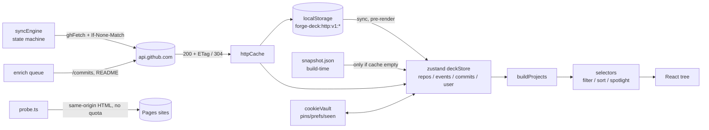

# KRUNKED // FORGE DECK — Architecture

Static, zero-backend launcher + live telemetry dashboard for a GitHub user (`GITHUB_USER` in `src/config/site.ts`).
Vite + React 19 + TypeScript (strict) + Tailwind v4 + Framer Motion + Zustand.

## 1. Data flow



Boot order: (1) synchronous `httpCache` read → store hydrated before first paint (<50 ms);
(2) if empty, `./snapshot.json` (generated at CI build, free same-origin); (3) background revalidation.

## 2. ETag / SWR state machine (`src/data/syncEngine.ts`)

States: `BOOT → HYDRATED(cache|snapshot|empty) → REVALIDATING → LIVE | RATE_LIMITED | OFFLINE | ERROR`

| From | Event | To | Notes |
|---|---|---|---|
| BOOT | cache/snapshot read | HYDRATED | UI renders immediately |
| HYDRATED/LIVE/ERROR | FORCE_SYNC, POLL_TICK, VISIBLE(>60 s stale), ONLINE | REVALIDATING | conditional requests |
| REVALIDATING | all core 304 | LIVE (`LIVE // 304 ETAG`) | zero quota used |
| REVALIDATING | any 200 | LIVE (`SYNCED`) | |
| REVALIDATING | 403/429 + remaining 0 / retry-after | RATE_LIMITED | timer resumes at `reset` |
| REVALIDATING | fetch TypeError | OFFLINE | cache stays on screen |
| any | `offline` window event | OFFLINE | |
| REVALIDATING | other 4xx/5xx | ERROR | |

Core endpoints: `/users/{u}` (≥30 min stale), `/users/{u}/repos?per_page=100&sort=pushed`, `/users/{u}/events/public?per_page=100`.
Requests use `cache:'no-store'` + explicit `If-None-Match` so the browser HTTP cache never masks the 304.
Poll interval = `max(POLL_MS, x-poll-interval)`; paused while the tab is hidden. `?sync=off` disables network sync (screenshots/tests).

## 3. Quota budget

| Call | Cost | Frequency |
|---|---|---|
| core ×3 | 0 when 304, else 1 each | ≤ 1 per 90 s visible |
| `/commits` (spotlight top 5) | skipped if cached `meta.pushedAt === repo.pushed_at` | on repo change |
| README / commits in Peek | 1 each, LRU-cached | on open |
| events pages 2–3 | 2 | ≤ once / 6 h, only if remaining > 20 |
| `/rate_limit` | free | boot, token test |

Budget guard: when persisted `remaining ≤ QUOTA_RESERVE` and `reset` is in the future, enrichment is skipped without touching the network.
Authenticated PAT (optional) raises the cap to 5000/h and is only ever sent to `https://api.github.com`.

## 4. PushEvent limitation

Public `PushEvent` payloads no longer carry `commits`/`size`/messages — only `ref`, `head`, `before`, `push_id`.
Commit message + SHA therefore come from `/repos/{o}/{r}/commits` (enrichment); the ship log shows `head.slice(0,7)` immediately and upgrades the line with the message when the commit is cached.
The user feed only spans ~90 days / 300 events; heat strip is explicitly labelled "public event window".

## 5. Same-origin implications

This repo is the user site, so every other app lives at `/<repo>/` on the **same origin**.
- localStorage/cookies are shared → all keys namespaced `forge-deck:*` (vault is `krunked-cookie-vault-v1`).
- Service worker scope `/` could capture neighbour apps → SW only handles the deck's own navigation URL and precached assets; everything else passes through (`src/domain/swScope.ts` mirrors the SW predicate and is unit-tested).
- Probing neighbour apps' HTML is same-origin → no CORS, zero quota. Iframes of siblings are same-origin; third-party `homepage` URLs may refuse framing → 8 s fallback panel.

## 6. Module tree

```
src/config      site.ts  projectOverrides.ts
src/types       github.ts  project.ts
src/data        httpCache rateLimit ghClient syncEngine enrich probe snapshot projections
src/domain      resolveLaunch classify humanize freshness activity shiplog fuzzy glyphs buildProjects swScope
src/art         hash prng noise color renderCover coverCache styles/{topo,orbital,synthwave,prism,groove}
src/vault       cookieVault patStore
src/store       deckStore selectors
src/hooks       useNow useSpecular useHotkeys useMediaQuery useInView
src/components  layout hero spotlight stream dock collection art viz palette peek settings ui
```
