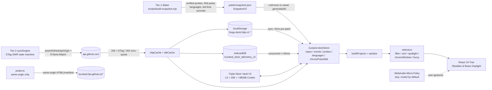

# KRUNKED // FORGE DECK V2 — Architecture

Zero-backend personal app launcher, sub-app portal, and real-time GitHub telemetry dashboard for `GITHUB_USER` (`krunked-fpv`). Built on Vite + React 19 + TypeScript (strict) + Tailwind v4 + Framer Motion + Zustand, engineered with industrial Braun/Teenage Engineering hardware craft, 3-tier telemetry, triple-redundant self-healing persistence, and strict client-side security boundaries.

---

## 1. Three-Tier Telemetry & Data Flow

### Boot Sequence (`< 50ms` First Paint)
1. **Pre-Paint Zero-FOUC Bootstrap (`index.html`)**: Synchronous inline `<script>` reads `prefs.theme` from `localStorage['krunked-cookie-vault-v1']` (falling back to shadow cookie decode) and sets `document.documentElement.dataset.theme`, `<meta id="meta-theme-color">`, and `colorScheme` before first paint.
2. **Synchronous Store Hydration (`deckStore.ts`)**: Reads core cached repos/events/user from `localStorage` (`< 5ms`) and synchronous `loadVaultSync()` (LS + Cookie) so React renders populated tiles on frame 1.
3. **Concurrent Tier-1 & IDB Hydration (`syncEngine.ts`)**: On `startEngine()`:
   - Runs `reconcileVault()` asynchronously across all 3 stores (healing any missing/stale mirror and upgrading store if IndexedDB holds a higher `rev`).
   - Fetches `./snapshot.json` (`SnapshotV2`) and reads `krunked_deck_telemetry_v2` IDB mirror concurrently. Even when `localStorage` already has cached repos, if `snapshot.generatedAt` is newer than the last ingested snapshot, `SnapshotV2` enriches `probes`, `languages`, `chronoPulse90d`, and bot-filtered `commits` without clobbering fresher live ETag responses.
4. **Tier-2 Conditional Revalidation**: Unless `?sync=off` is present, triggers conditional `If-None-Match` GETs against `https://api.github.com`.

---

## 2. ETag / SWR State Machine (`src/data/syncEngine.ts`, `syncReducer.ts`)

States: `BOOT -> HYDRATED(cache|snapshot|empty) -> REVALIDATING -> LIVE | RATE_LIMITED | OFFLINE | ERROR`

| From | Event | To | Notes |
|---|---|---|---|
| `BOOT` | cache / IDB / snapshot read | `HYDRATED` | First paint `< 50ms` |
| `HYDRATED`/`LIVE`/`ERROR` | `FORCE_SYNC`, `POLL_TICK`, `VISIBLE` (`>60s` stale), `ONLINE` | `REVALIDATING` | Conditional requests (`cache: 'no-store'`) |
| `REVALIDATING` | all core `304` | `LIVE` (`LIVE // 304 ETAG`) | Zero quota consumed; `touch(url)` |
| `REVALIDATING` | any `200` | `LIVE` (`SYNCED`) | Updates cache, store, fires `sync` foley cue if unmuted |
| `REVALIDATING` | `403`/`429` (remaining 0, secondary limit, or `Retry-After`) | `RATE_LIMITED` | Parses numeric OR HTTP-date `Retry-After` (min 60s backoff); auto-resumes at `resetAt` |
| `REVALIDATING` | `TypeError` / network failure | `OFFLINE` | Preserves hydrated data on screen |
| any | `offline` window event | `OFFLINE` | |
| `REVALIDATING` | other 4xx/5xx | `ERROR` | |

- **304 Cache-Miss Recovery**: If a `304` arrives after its cache body was evicted, `ghClient.ts` performs one clean unconditional retry instead of throwing `HttpError(304)`.
- **Teardown**: `stopEngine()` cleanly removes visibility/online/offline listeners and timers for deterministic test isolation.
- **`?sync=off` Gate**: Shared `syncDisabled()` guard short-circuits `startEngine()`, `forceSync()`, `enrichCommits()`, `enrichLanguages()`, `enrichReadme()`, and `probe()` so preview/test sessions emit zero network requests and zero console errors.

---

## 3. Cold-Boot Quota Budget

| Call | Cost | Policy |
|---|---|---|
| Core endpoints (`/users/{u}`, `/repos`, `/events/public`) | `0` on `304`, else `1` each | `<= 1` per `max(90s, x-poll-interval)` while visible; cold boot `<= 3` unauthenticated calls |
| `/commits` per repo | `0` when `SnapshotV2` or cache `pushedAt === repo.pushed_at` | Enriched lazily only when repo `pushed_at` advances beyond cached/snapshot `pushedAt` |
| `/languages` per repo | `0` when present in `SnapshotV2.languages` | Fallback fetch only on Peek open when missing and `!budgetExhausted()` |
| `/readme` | `1` (LRU + IDB cached) | On Peek Brief tab open only (blocked under `?sync=off`; 404 cached cleanly without unhandled error) |
| Deep events pages 2–3 | `2` | Never fired on unauthenticated cold boot; only on explicit refresh/idle when `remaining > 20` and stale `> 6h` |
| `/rate_limit` | `0` (free) | Boot when syncing & manual PAT verification |

---

## 4. Security Boundaries

### 4.1 Local PAT Origin Firewall (`src/vault/patStore.ts` + `src/data/ghClient.ts`)
- PAT is stored strictly under `krunked-local-pat-v1` in `sessionStorage` (`session`) or `localStorage` (`device`).
- `assertGitHubApiOrigin(url)` parses via `new URL()` and throws unless `protocol === 'https:'`, `origin === 'https://api.github.com'`, and `username === '' && password === ''`.
- `getAuthHeadersForUrl(url)` attaches `Authorization: Bearer <token>` ONLY after passing `assertGitHubApiOrigin(url)`.
- `setPat()` rejects whitespace/control characters (`\r`, `\n`, `\x00-\x1f`). Zero console logging; zero cookie/vault/export inclusion.

### 4.2 Triple-Redundant Vault Isolation (`src/vault/cookieVault.ts` + `configIo.ts`)
- Bidirectional auto-healing across `localStorage`, IndexedDB (`krunked_vault_v1`), and `< 3800B` `SameSite=Lax` shadow cookie (`v2.<base64url>.<fnv1a32hex>`).
- Monotonic `rev` prevents clock-skew clobbering. 4-stage progressive shedding guarantees the shadow cookie never exceeds browser 4KB limits.
- `KrunkedDeckConfigV2` export/import enforces 2 MB cap, schema tag check, prototype-pollution key rejection, strict string/URL/emoji sanitization, and guaranteed PAT stripping.

### 4.3 Self-Iframe Guard & Sandboxing (`src/domain/resolveLaunch.ts` + `SandboxFrame.tsx`)
- `isSelfHostedPeekTarget(url, currentLocation, owner)` blocks both `http:` and `https:` canonical `<owner>.github.io` root URLs as well as the active `origin + pathname`, preventing recursive deck-in-deck framing on production GitHub Pages AND local preview servers.
- Permitted iframes render with `sandbox="allow-scripts allow-same-origin allow-forms allow-popups"` and `allow="fullscreen; gamepad; autoplay"`.

### 4.4 Same-Origin Sub-App Isolation (`vite/pwaPlugin.ts` + `src/domain/swScope.ts`)
- Because Forge Deck is hosted at `https://krunked-fpv.github.io/`, every sibling app lives at `/<repo>/` on the same origin:
  - All storage keys are namespaced (`forge-deck:*`, `krunked-cookie-vault-v1`, `krunked-local-pat-v1`, `krunked_vault_v1`, `krunked_deck_telemetry_v2`).
  - The service worker (`forge-deck-v2-<hash>`) strictly allowlists ONLY the deck's own scope navigation (`/` or `/index.html`), `./snapshot.json`, `./manifest.webmanifest`, `./assets/*`, `./favicon.svg`, and `./icons/*`. Every sibling `/<repo>/*` request and every `api.github.com` request passes straight through untouched.
  - Client-side HTML probing (`probe.ts`) only runs for same-origin URLs when `location.origin === PAGES_ORIGIN` (zero cross-origin CORS spam on localhost).

---

## 5. V2 Module Ownership Map

| Specialist | Exclusive Paths | Responsibility |
|---|---|---|
| **marcus** | `SPEC.md`, `ARCHITECTURE.md`, `HANDOFF.md`, `README.md`, `src/types/*`, `src/config/*` | System architecture, locked TS contracts, config & overrides |
| **claire** | `src/index.css`, `src/components/ui/*`, `src/components/layout/*`, `src/components/hero/HeroBand.tsx`, `src/components/hero/StatCounter.tsx` | Dual hardware themes (Obsidian + Braun Daylight), AA tokens, TopBar/HeroBand/StatusBar, UI primitives |
| **elena** | `src/art/*`, `src/components/art/*`, `src/components/viz/*`, `src/components/hero/HeatStrip.tsx` | Dual-theme procedural covers, drafting pass, 90d interactive Chrono-Pulse, 30d sparkline, ISO 18004 QR SVG, Swiss emblem |
| **kenji** | `src/audio/*`, `src/test/audio.test.ts` | Lazy muted-by-default WebAudio micro-foley DSP (`tick`/`click`/`latch`/`relay`/`sync`) + `useFoley`/`useFoleySync` |
| **nadia** | `src/data/*`, `src/domain/*`, `src/store/*` | Dual-layer cache (LS+IDB), `SnapshotV2` ingestion, ETag SWR engine, XSS/emoji sanitization, 404 demotion, UTC activity, Zustand store & fuzzy selectors |
| **soren** | `scripts/build-snapshot.mjs`, `public/snapshot.json` | Zero-dep Tier-1 harvester: Pages 404 verification, HTML/manifest metadata, language byte maps, bot-excluded 90d Chrono-Pulse |
| **viktor** | `src/vault/*`, `src/test/vault.test.ts` | Triple-store auto-healing Vault V2 (`LS + IDB + <3800B Cookie`), `KrunkedDeckConfigV2` I/O, PAT origin firewall |
| **devon** | `src/App.tsx`, `src/main.tsx`, `src/hooks/*`, `src/components/{spotlight,stream,dock,collection,palette,peek,settings}/*` | Interactive shell, `usePwaInstall`, hotkeys & spatial nav, SpotlightDeck, ForgeStream, FlagshipDock, Bento/Grid/Matrix, 4-tab PeekDrawer, CommandPalette, 3-tab SettingsModal |
| **tomas** | `index.html`, `vite.config.ts`, `vite/*`, `scripts/generate-icons.mjs`, `public/icons/*`, `public/favicon.svg`, `public/.nojekyll`, `.github/workflows/*`, `package.json` | Zero-FOUC dual-theme bootstrap, scope-safe SW & Manifest V2, 4×4 supersampled industrial PNG icons, 2-job CI + PR audit |
| **hana** | `src/test/{art,domain,ghClient,v2Audit}.test.ts` | Adversarial unit/contract suites + live `1440x900` & `375x812` dual-theme browser QA |
